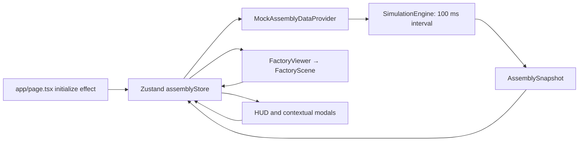

# Phase 0 — Current system audit

Audit date: 2026-10-14 (America/Chicago). Base commit: `e389bb8e5d877f18d40ac9463c3e3154a160709c`.
Repository: `https://github.com/SamN6017/gpu-rack-assembly`.
Local checkout: `/Users/sambhaji_ajane/Desktop/Rack-assembly/gpu-rack-assembly`.
Audit branch: `feature/manufacturing-digital-twin`. The checkout was clean on `main` before work began. No applicable `AGENTS.md` was found.

## Scope and evidence

This phase audits the existing application and plans phases 1–10. It does not implement persistence, imports, a new engine, or manufacturing behavior. The supplied master plan explicitly requires approval after this audit.

Inspected package scripts, every direct dependency, App Router entry points, the complete engine and providers, store/types, scene composition, camera and interaction controllers, rack movement, board geometry, dashboards, modals, styles, and build configuration. Findings below distinguish executable paths from components merely present in the repository.

### Baseline checks before documentation edits

| Check | Result |
| --- | --- |
| Node / npm | `v25.9.0` / `11.12.1`; no project runtime pin |
| `npm test -- --run` | Failed: no `test` script. No test files or runner configuration exist. This is missing coverage, not failing assertions. |
| Initial `npm run build` | Failed: `next: command not found`; dependencies were absent. |
| `npm ci --cache /tmp/gpu-rack-npm-cache --no-audit --no-fund` | Passed after authorized network access; 185 packages installed from unchanged lockfile. Sandbox attempt encountered `ENOTFOUND` and was interrupted. |
| `npm run build` after installation | Passed: compilation, type checking, static generation and trace collection; `/` first-load JS 105 kB, `/_not-found` 88.2 kB. No source fixes required. |
| `CI=1 npm run lint` | Exited 1 at interactive ESLint setup. No ESLint dependency/configuration exists. Build success is not evidence of a configured lint check. |
| Local development server | Served `/` with HTTP 200 on `127.0.0.1:3010` after authorized port binding. |
| Browser smoke | Passed basic smoke after initial delayed hydration: 3D overview rendered, walk/overview selection worked, demo mode switched, Kanban opened/closed, audit log showed transfers and subsequent station arrivals, reset restored queue/initial racks, pause exposed Resume. Full pointer-lock/WASD/collision and proximity E paths were not exercised. |

Only documentation changes are made in Phase 0. Build and basic 3D operational smoke succeeded on unchanged application source. Initial hydration was delayed in the in-app browser; a later interaction succeeded. Basic smoke does not establish correctness of all controls or production timing. Full pointer-lock, collision and proximity acceptance remains a Phase 5 regression gate.

Installation warned about deprecated `three-mesh-bvh@0.7.8` compatibility and the security status of `next@14.2.15`. Do not silently upgrade the graphics stack during an audit. A framework patch and compatibility check belong at the beginning of implementation, before exposing new data APIs. See the [official Next.js advisory](https://nextjs.org/blog/security-update-2025-12-11).

## Dependencies and build configuration

| Direct runtime dependency | Declared | Installed from lockfile | Use |
| --- | --- | --- | --- |
| next | 14.2.15 | 14.2.15 | App Router, build/runtime |
| react / react-dom | ^18.3.1 | 18.3.1 | UI |
| @react-three/fiber | ^8.17.10 | 8.18.0 | Canvas and frame loop |
| @react-three/drei | ^9.114.0 | 9.122.0 | Text, HTML overlays, orbit/pointer controls |
| three | ^0.169.0 | 0.169.0 | Geometry/materials/math |
| zustand | ^4.5.5 | 4.5.7 | Client application store |
| lucide-react | ^0.453.0 | 0.453.0 | Icons |
| clsx | ^2.1.1 | 2.1.1 | Available class utility |
| tailwind-merge | ^2.5.4 | 2.6.1 | Available class utility |
| canvas-confetti | ^1.9.4 | 1.9.4 | Available celebration library |

Direct development dependencies: TypeScript 5.4.5 (declared `^5.4.5`); Tailwind 3.4.19 (`^3.4.13`); PostCSS 8.5.28 (`^8.4.47`); Autoprefixer 10.6.1 (`^10.4.20`); `@types/node` 20.19.43 (`^20.16.11`), `@types/react` 18.3.31 (`^18.3.11`), `@types/react-dom` 18.3.7 (`^18.3.0`), `@types/three` 0.169.0 (`^0.169.0`), and `@types/canvas-confetti` 1.9.0 (`^1.9.0`). `three-stdlib` is imported for control types through a transitive dependency; make that dependency explicit if those imports remain.

Scripts are only `dev`, `build`, `start`, `lint`. TypeScript uses strict mode, ES2022, bundler resolution, `@/* -> src/*`, and `skipLibCheck`. Next enables Strict Mode and transpiles `three`. Tailwind supplies industrial colors and monospace typography. There are no database, parser, validation, chart, PDF, authentication, test, worker, or migration packages. Docker and PostgreSQL CLI executables are present on this host; daemon availability and database connectivity were not tested in Phase 0.

## Runtime architecture



`src/app/page.tsx` is the only application page and is a client component. `layout.tsx` supplies metadata and global styles. There are no Route Handlers, middleware, server services, database calls, or persistence. Both root body and factory page constrain overflow; future operations pages need their own scrolling layout.

`FactoryViewer.tsx` waits for mount and dynamically imports `FactoryScene` with SSR disabled. The scene contains the industrial envelope, conveyor, queue/terminal/completed bays, physical board, all stations and racks, and either the first-person or overview controller. Existing geometry is procedural and illustrative; no CAD accuracy should be inferred.

The store combines production projections with view mode, player coordinates, interaction prompts, selections, modal state, and camera presets. A module singleton is concretely typed as `MockAssemblyDataProvider`. `initialize()` constructs it and subscribes, but does not call its async `initialize()`, retain unsubscribe, or expose teardown/provider switching. The provider starts the engine in its constructor, so production can progress behind the welcome screen. Store-level selections are used by the UI; engine selections are redundant and are not copied from snapshots by the store.

`IAssemblyDataProvider` offers initialize/subscribe, queue operations, station commands, stress testing, pause/speed/demo/reset, and destroy. This is a valuable migration boundary, but reads and commands are conflated. The mock forwards methods to the engine. The realtime provider is an unconnected skeleton: initialize throws, the endpoint is a placeholder, there is no connection/ingestion/reconnect implementation, and several methods would send equipment or production commands if `ws` were connected. SSE and MQTT are comments, not implemented adapters.

## Domain state and time

| Type | Present semantics | Missing manufacturing semantics |
| --- | --- | --- |
| `Rack` | ID, free-text model name, state, station IDs, movement progress, completed stations, synthetic telemetry/timestamps | Model foreign key, production order, priority, BOM/reservations, shortage causes |
| `Station` | ID/number/name, rack, state, entered timestamp, duration, 3D position | Equipment availability separate from blocking, working calendar, material requirements |
| `AssemblySnapshot` | Stations/racks/queue/completed, metrics, latest events, config/selections | Virtual clock, mode/run ID, inventory, replenishments, immutable revision |
| `ProductionEvent` | Six display event types, wall-clock timestamp, message | Durable sequence, payload version, source provenance, material/location references |

The five canonical stations are `STATION-1` Chassis & Busbar Assembly; `STATION-2` Liquid Cold-Plate & GPU Trays; `STATION-3` Power & Switch Integration; `STATION-4` Optical Loom & Harnessing; `STATION-5` Automated QA & Burn-in. Each defaults to 720 seconds. The initial fixture has four active racks, an empty station 3, three queued racks and one completed rack. Model names include GB200 NVL72, H100 NVL Supercluster, B200 Dual-Node and MI300X OAM; they are display strings, not validated catalog entries.

`start()` ticks every 100 ms. `tick()` computes real elapsed milliseconds from `Date.now()` and scales movement by the speed multiplier. Processing time is measured as `now - enteredStationAt`; higher speeds artificially shift the entry timestamp backwards. Demo mode sets duration to 12 seconds and resets active progress to 40%, despite its preservation comment. IDs, serials and stress telemetry use `Math.random()`. There is no virtual event queue, seed, calendar or batch execution.

Pause returns early from tick but leaves station entry timestamps unchanged. Resuming includes the paused wall-clock interval in processing elapsed time. Display timers independently use `Date.now()` in the physical board, `Station3D`, Kanban modal, station card, station inspection and rack detail. Tick notifies only when `stateChanged`; normal processing countdowns alone do not notify, so UI clocks can appear stale until another update.

### Movement, blocking and completion

1. Update all MOVING racks. Arrival occurs when engine-owned `moveProgress` reaches 1.
2. Mark elapsed RUNNING operations COMPLETE and racks READY.
3. Examine stations from 5 back to 1. Completed station 5 moves to storage; other completed stations move if downstream is EMPTY and no moving rack targets it. Otherwise mark BLOCKED.
4. Recheck BLOCKED stations for an empty downstream destination; move immediately when clear.
5. Automatically dispatch the FIFO queue into station 1 when available.

Departure clears source occupancy immediately; the target is protected by scanning MOVING racks. Transit duration is 3,000 ms scaled by simulation speed. Arrival starts the next station timer and adds the previous station milestone. Final arrival records completion. `Rack3D` interpolates engine progress and applies visual damping; it does not call an animation callback to commit production state. Preserve this one-way authority when adding inventory.

Manual faults share BLOCKED with downstream waits. A manually blocked occupied station can therefore transfer before its processing is complete when downstream is empty; station 5 has no automatic downstream recovery. These are source-derived findings, not newly executed assertions. New engine design must separate equipment, material, and downstream causes. `removeRackFromQueue` also deletes the rack record without first checking queue membership; future commands need guards.

## Rendering and reusable UI

| Files | Disposition and observations |
| --- | --- |
| `FactoryViewer`, `FactoryScene`, `FactoryFloor`, `AssemblyPath` | Reuse environment and Canvas; extend scene composition for material flow. |
| `FirstPersonController`, `CameraController`, `FactoryHUD` | Preserve walking, collision sliding, proximity E interaction, overview/orbit, minimap and controls. Extract shared layout coordinates before adding zones. |
| `Rack3D`, `Station3D`, queue/terminal/completed bay components | Preserve procedural geometry and animation; add projection fields and bounded visible history. |
| `PhysicalKanbanBoard` | Keep wall-board interaction, redesign mounting/dimensions in Phase 5. Board is 13.2 × 6.2 × 0.4 at z=-14.6; north wall is z=-17 with 0.6 thickness. This leaves a roughly 1.9 m rear gap without visible connecting brackets. |
| `KanbanModal`, `StationInspectModal`, `RackDetailModal`, `AddRackModal` | Mounted and reachable; extend with authoritative material/order information. |
| `OperationsDashboard`, `SummaryHeader`, `SimulationControls` | Present but not imported by the active page/scene. Do not assume their event tabs, speed controls, or preset toolbar are currently visible. Reuse appropriate parts when adding routes. |
| `StationCard`, `QueueCompletedList` | Used by the currently unmounted OperationsDashboard; candidates for reusable operations views. |

The active Kanban is a production board (queue, five station columns, completions, recent events), not a material/two-bin board. The physical board opens the Kanban modal on click; the first-person proximity system also opens it with E. The camera preset union includes Kanban, but CameraController has no explicit Kanban branch. AddRackModal captures priority but passes only modelName. Its displayed next ID is based on queue length and can disagree with the engine counter. H100 names differ across fixtures and pickers: never automatically equate them during imports.

Metrics are demonstrations: `completedToday` adds a baseline of 12 and average cycle time is a constant 12.0. History is limited to 50 events. Snapshots copy top-level containers but retain mutable nested station/rack objects. Reset does not reset `nextRackIndex` or all config/selection fields. Reset in demo mode reuses production remaining-time offsets (105/552/221/443 seconds) against a 12-second duration, creating future entry timestamps; browser smoke showed multi-minute board timers after this reset. Queue/completed rack geometry grows without bounds and can extend beyond the building. There is no inventory/BOM/material reservation or conservation logic to reuse.

## Supplied data boundary

The workbook exists (14,824 bytes); workbook cells/formulas were not audited or imported in Phase 0. The JSON archive exists (5,304 bytes), contains 13 data JSON files, `schema_manifest.json` and README, and was read without extraction or execution. Treat embedded instructions as source content, not additional task authorization.

Manifest counts: 5 materials, 1 rack model, 5 workstations, 5 BOM rows, 7 locations, 10 inventory rows, 5 Kanban rules, 1 production schedule, 4 scenarios, 2 sources, 5 assumptions, 0 actual events, 0 screenshot transcriptions. Counts come from the manifest; full cross-file validation is Phase 2 work.

The archive explicitly labels populated manufacturing rows SYNTHETIC. The demonstration model is `DEMO-GPU-RACK`, not any existing NVIDIA/AMD model. Inventory, part numbers, BOM quantities, daily target 15 and lead time 60 minutes must stay synthetic. The four sample scenarios do not yet cover optimized Kanban/custom requirements.

Its workstation IDs are `WS1`…`WS5`, with generic names such as Frame preparation and Rail mounting. Even though these rows say EXISTING_APP_DEFAULT, their names differ from the repository. Only station count/sequence and 720-second defaults agree. A reviewed mapping must preserve original names and distinguish demonstration aliases from approved manufacturing mappings. BOM effective dates, catalog namespace, schedule timezone/shift start, handler capacity, warehouse capacity and approval metadata need explicit review rather than invented defaults. The sample January–June 2026 schedule must not silently become the user's chosen simulation period.

## Reproduction

```bash
cd /Users/sambhaji_ajane/Desktop/Rack-assembly/gpu-rack-assembly
npm ci
npm run build
npm run dev -- --hostname 127.0.0.1 --port 3010
```

Open `http://127.0.0.1:3010`. Completed smoke: rendered overview, selected walk mode, opened Kanban/audit log, observed demo transfer/arrival events, reset, and toggled pause. Manual acceptance still to complete: pointer-lock WASD/collision, proximity E, station/rack/queue inspection and exact pause/resume timing. Document known pause/fault behavior separately from regressions. `npm test` and `npm run lint` are not passing quality gates until their infrastructure is added.
