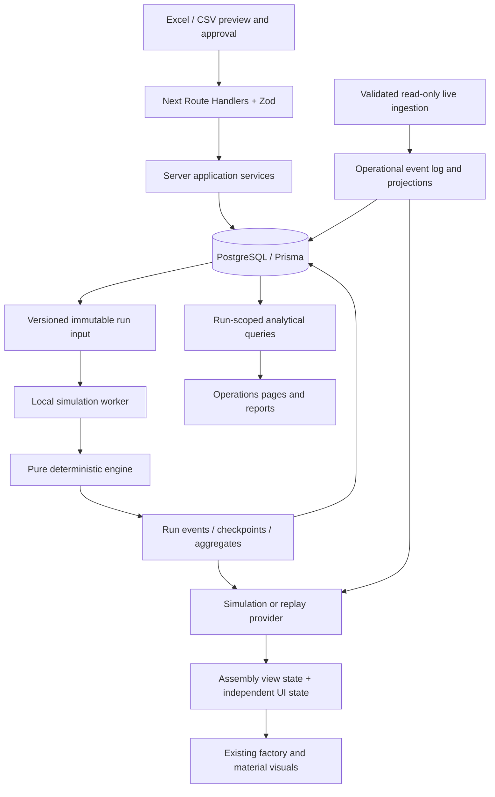

# Target manufacturing architecture — proposal

Status: design only, awaiting approval after Phase 0. Read with [current-system.md](current-system.md) and [implementation-plan.md](../implementation-plan.md).

## Boundaries

Keep the existing Next.js factory route, React Three Fiber scene, geometry, cameras, collision/proximity controls and Zustand UI actions. Introduce a pure TypeScript manufacturing domain and a compatibility projection into the existing `AssemblySnapshot`. Keep the existing demo provider available while a tested deterministic provider is introduced; replace the timer implementation only after parity and manufacturing acceptance checks.

The engine has no React, Three.js, browser timers or database imports. A server worker receives a complete immutable input; it cannot call operational inventory services. HTTP creates/queries jobs and returns promptly. Use PostgreSQL-backed job claiming with leases/recovery before introducing an external queue service. A browser Web Worker may later serve bounded local previews; it is not required for the first persistent batch implementation.

SIMULATION, LIVE and REPLAY are explicit discriminated modes in snapshots/providers. Factory projection includes mode, run/source ID, revision, virtual/display time, capabilities, connection status and last confirmed event time. UI uses projected time, not Date.now(), for production countdowns. Smooth interpolation remains a visual detail. Snapshots are immutable, sampled for playback, and seekable from checkpoints plus subsequent meaningful events.

Separate provider subscriptions from simulation command capabilities. Simulation permits controls and manual demonstration faults. Live has no write capability; remove outbound command behavior before connecting the existing realtime skeleton. Source switching disposes subscriptions/transports, clears stale projections, and never runs two active providers. Preserve existing action names through adapters while capabilities govern availability.

## Proposed database schema

Use UUID primary keys, UTC `timestamptz`, decimal quantities (proposed `numeric(20,6)` with explicit per-unit precision validation), foreign keys with RESTRICT for retained history, and created/updated timestamps on mutable records. Return decimals as strings in API contracts. Immutable records have creation/occurrence timestamps, never mutable audit fields. JSON is versioned and validated at every input boundary. Add indexes on foreign keys used in joins; PostgreSQL does not create all such indexes automatically.

All fields requested in the master plan remain in scope. The additions below close requirements not represented by its initial field list.

| Entity | Fields and relationships | Constraints / indexes |
| --- | --- | --- |
| Material | id, **catalogNamespace**, partNumber, description, category, unitOfMeasure, sourceReference, createdAt, updatedAt; provenance link | Unique (catalogNamespace, partNumber); namespace required, no cross-source fuzzy merges |
| RackModel | id, modelCode, modelName, description, isActive, timestamps, provenance | Unique modelCode; source aliases reviewed separately; never merge by display name |
| Workstation | id, stationCode, name, sequence, cycleTimeSeconds, isActive, timestamps | Unique stationCode and sequence for this single line; positive cycle/sequence; seed existing five canonical stations |
| BillOfMaterial | id, rackModelId, materialId, workstationId, quantityPerRack, effectiveFrom, effectiveTo, sourceReference, timestamps, provenance | Quantity > 0; end > start when present; index (rackModelId, workstationId); disallow overlapping effective ranges per model/material/station using SQL exclusion constraint |
| InventoryLocation | id, code, name, locationType, parentLocationId, timestamps | Unique code; types WAREHOUSE/KANBAN_STORAGE/POINT_OF_USE/IN_TRANSIT; self-FK, no self-parent or cycles |
| InventoryBalance | id, materialId, locationId, quantityOnHand, quantityReserved, updatedAt, createdAt | Unique (materialId, locationId); onHand >= 0; 0 <= reserved <= onHand |
| InventoryEvent | id, materialId, sourceLocationId?, destinationLocationId?, quantity, eventType, occurredAt, sourceSystem, externalEventId, correlationId, createdAt; source/raw reference, payloadHash | RECEIPT/TRANSFER/CONSUMPTION/ADJUSTMENT/RETURN; immutable; unique (sourceSystem, externalEventId); indexes material/time, source/time, destination/time, correlation |
| KanbanRule | id, materialId, sourceLocationId, destinationLocationId, numberOfBins, unitsPerBin, reorderPoint, targetStock, replenishmentLeadMinutes, safetyStock, enabled, timestamps | Unique material/source/destination policy; source != destination; bins integer >= 2; capacity > 0; lead >= 0; 0 <= safety <= reorder <= target <= total bin capacity |
| ReplenishmentOrder | id, materialId, sourceLocationId, destinationLocationId, requestedQuantity, deliveredQuantity, status, requestedAt, dispatchedAt?, deliveredAt?, timestamps; ruleId?, idempotencyKey | REQUESTED/PICKING/IN_TRANSIT/DELIVERED/CANCELLED; 0 <= delivered <= requested; requested > 0; index status/requestedAt, material/destination; unique request key |
| ProductionOrder | id, rackModelId, rackSerialNumber, priority, status, scheduledStart, actualStart?, completedAt?, timestamps | Operational orders only; unique serial; bounded integer priority; validated status transitions; index status/priority/scheduledStart |
| SimulationScenario | id, name, description, durationDays, productionScheduleJson, initialInventoryJson, kanbanOverridesJson, simulationSeed, createdAt, updatedAt; startDate, durationMonths?, calendarTimezone, schemaVersion | Positive duration; calculate durationDays from calendar interval when months chosen; validate all JSON references and approvals |
| SimulationRun | id, scenarioId, status, startedAt?, finishedAt?, simulatedStart, simulatedEnd, inputSnapshotJson, configurationVersion, engineVersion, simulationSeed, summaryJson, createdAt, updatedAt; inputHash | Index scenario/createdAt, status; immutable input once queued; terminal result checksum; run snapshot sufficient even after scenario edits |
| SimulationEvent | id, runId, sequenceNumber (bigint), virtualTimestamp, eventType, materialId?, rackId?, workstationId?, payloadJson, createdAt | Unique (runId, sequenceNumber); indexes run/time and run/type/time plus eventType; rackId is run-local, never an operational production-order FK |
| DataSource | id, name, sourceType, connectionStatus, configurationJson, lastSyncAt?, timestamps | EXCEL/CSV/MANUAL/SIMULATION/ERP/MES/WMS/IOT; configuration contains secret references only; freshness/error metadata |
| ImportBatch | id, sourceId, filename, checksum, importedAt?, status, rowCount, acceptedRows, rejectedRows, validationReportJson, timestamps; mappingVersion, schemaVersion, approval reference | Counts nonnegative; accepted+rejected=rowCount at terminal state; source/checksum/mapping index; explicit re-import policy |

### Supporting records and when introduced

Phase 1 includes `DataProvenance` (entity/field, OBSERVED/DERIVED/ASSUMED/UNKNOWN, source reference and raw value), `DataAssumption` (typed value/unit, rationale, proposed/approved/rejected status, approver/time/version), and `InventoryReservation` (material/location, operational order/operation, quantity, status and unique idempotency key). Evidence classification and dataset kind are separate: `SYNTHETIC` is a dataset kind, not a new claim of observed evidence. Existing-app defaults are assumptions with a repository source reference. This avoids approving a synthetic record into actual data by accident.

Phase 2 adds `ImportRow` staging with worksheet/row/column, raw/normalized payload, validation results and provenance; approvals reference exact content hashes. Phase 3 adds `SimulationJob`, `SimulationSnapshot` and daily/material/station aggregates keyed by run. Simulated production orders, inventory reservations and replenishments reside in run events/checkpoints and, if query performance requires tables, in explicitly run-scoped tables. They never use operational InventoryBalance, InventoryEvent, ProductionOrder or ReplenishmentOrder.

Phase 4 adds per-bin configuration/state in simulated snapshots; operational bin configuration can be a separate `KanbanBin` with rule/location/bin index and capacity. Phase 9 adds `RawManufacturingEvent`, `IngestionCursor`, `OperationalProjectionCheckpoint` and immutable `AuditRecord` for ingestion/reconciliation. These later migrations are explicitly planned, not assumed present in Phase 1.

### Transactions and accounting

Operational receipt/transfer/consumption/return/adjustment uses a single transaction: validate event, insert deduplication key, lock affected balances in stable order, validate available quantity, update balances/reservations, append event, commit. Retry serialization conflicts with a bounded policy. Identical idempotency key and payload returns original result; changed payload under the same key is a conflict. A transfer records one event with both locations and applies both balance deltas atomically. Transit is an explicit location: dispatch source→transit, delivery transit→destination.

Positive quantities are mandatory except signed adjustments. Receipt has only a destination, consumption only a source, transfers require distinct source/destination, return semantics specify the returned-to location, and adjustment has a signed delta applied to one location with a mandatory reason. Reserve/release affect available stock but are not physical movements. Consumption consumes the reservation exactly once using order/operation/material identity. SQL checks, indexes and append-only event triggers supplement Zod; do not rely on UI validation. Reject UPDATE/DELETE of inventory events for application roles; corrections append compensating events.

Opening balances must be auditable receipts or reconciled cutover events. Every material/location reconciles opening + receipts + transfers in + returns - consumption - transfers out +/- adjustments = closing. No operational seed may invent stock. A synthetic fixture creates only a demonstration scenario and never actual balances/events.

BOM effectiveness uses half-open intervals [from, to). Select and freeze BOM versions in the run input; specify whether future effective changes apply at operation start in the configuration. Missing dates on supplied demo rows require an explicit approved scenario assumption. Decimal precision, unit conversions and fractional versus indivisible units are validated before engine execution.

## Simulation and Kanban design

Use a heap ordered by virtual timestamp, documented event priority and monotonically increasing sequence. Calendar boundaries and deliveries precede starts at the same instant; ordering is versioned. Use injected seeded randomness only where stochastic distributions are explicitly configured. Integer virtual time and scaled integer material quantities avoid drifting totals. Six calendar months use calendar addition with end-of-month clamping in an explicit plant timezone; shift expansion accounts for DST. Store UTC instants and use [start, end) reporting ranges.

Event contract includes all requested events: PRODUCTION_ORDER_CREATED, RACK_QUEUED, STATION_STARTED, MATERIAL_RESERVED, MATERIAL_CONSUMED, STATION_COMPLETED, RACK_MOVED, RACK_BLOCKED, MATERIAL_SHORTAGE, REPLENISHMENT_REQUESTED/PICKED/DISPATCHED/DELIVERED, STATION_RESUMED, RACK_COMPLETED, SHIFT_STARTED/ENDED and SIMULATION_COMPLETED. Add UPSTREAM_SUPPLY_SHORTAGE and explicit equipment-state events. Monotonic run sequence is independent of browser animation frames.

A station starts only after all BOM reservations succeed atomically. Default consumption is at start; configurable completion consumption retains reservations and has defined cancellation/release semantics. Equipment faults, material shortage, off-shift time and downstream occupancy are distinct causes. Default proposal: pause unfinished processing outside working shifts, resume remaining work next shift; make transport calendars explicit. FIFO tie-breaks apply within production priority. Finite buffers and downstream holds prevent double occupancy.

Kanban checks availability and inventory position, subtracts existing orders, and requests max(0, target - (onHand + onOrder - reserved)). Single outstanding demand is enforced by state/transaction locking, not repeated polling. Reserve finite source stock before handler assignment; respect handler availability, picking/transport times and capacity. Partial supply policy is explicit and never silently completes an order. Source exhaustion emits an upstream shortage and waits for an explicit supply event/policy. Repeated shortages are counted as episodes rather than every reevaluation.

Bins are FULL/ACTIVE/EMPTY/REPLENISHING; count and capacities are configurable. Coverage is available / expected consumption per consistent time unit; a zero rate yields a named no-demand result, not a numeric division. Validate safety/reorder/target capacity relationships. Station start after delivery retries the same blocked operation without duplicate consumption.

Pause/resume/step event/step minute/jump date/run-complete are engine controls, independent of playback speed. Checkpoints allow seeking without all animations. Persist meaningful events and time-weighted stock/utilization metrics, including unresolved downtime and WIP at horizon end. Reports count operation consumption, not only completed racks; reconcile WIP consumption separately. Calendar-month totals must sum to the entire run.

## Imports, reports and future live integration

The import wizard stages bytes → sheets → mapping → preview → errors → explicit confirmation → transaction. File limits, extension/signature checks, bounded ZIP expansion, row/cell limits and formula-cell policy precede parsing. Do not evaluate formulas or silently trust cached results. Normalize headers and documented units while retaining originals; reject ambiguous aliases, duplicate namespace/part keys and invalid relationships. Store checksums and row-level source references. Workbook/JSON agreement is a later explicit validation, not assumed from matching filenames.

`data/raw`, `data/normalized`, `data/assumptions`, `data/samples` separate original sources, reviewed transcription, decisions and synthetic examples. Keep private raw files out of Git unless intentionally approved for versioning. Source data availability does not imply approval. Baseline is either approved-source baseline or clearly named synthetic baseline until actual evidence exists.

Add operations routes for Kanban, inventory, production, replenishment, analytics, scenarios, reports and sources. All analytical views explicitly select run/mode. Include station/material/model/status filters, replenishment timeline and ten requested charts. Shared aggregates serve dashboards and Excel/CSV/PDF reports. Export formula-leading strings safely, use usable typed Excel tables, and label every result as simulated with seed, engine/config versions, assumptions, missing data and source references. Recommendations are rules tied to measured shortages/downtime; comparisons are required before claiming optimization.

Live envelope: eventId, sourceSystem, sourceTimestamp, ingestionTimestamp, eventType, material/rack references, location, optional quantity and unit, payloadVersion, correlationId and raw reference. Validate, deduplicate, retain late events, and use source sequence/watermark plus replay/reconciliation for out-of-order delivery. Connections remain read-only; no source adapter sends production or equipment commands. Add authentication/authorization before any real factory integration. REST, SSE/WebSocket, imported-event and mock-live adapters share this contract; MQTT remains a transport boundary until separately implemented.

## Dependencies and compatibility decisions

Phase 1: Prisma CLI/client at the same pinned version, PostgreSQL driver/adapter required by that version (`pg`, `@prisma/adapter-pg` for Prisma 7), Zod, `server-only`, environment loader for standalone scripts, `tsx`, Vitest, and configured ESLint tooling compatible with the selected Next release. Reuse React 18/R3F 8/Drei 9/Three 0.169 during initial persistence work. PostgreSQL 17 is the proposed local database family; pin a maintained image tag/digest during implementation. Do not run an unqualified latest ORM upgrade without resolving its runtime/module/driver requirements.

Choose and pin a supported LTS Node runtime before installing new tooling. The audited host runs Node 25; Prisma's [versioned system requirements](https://www.prisma.io/docs/orm/v7/reference/system-requirements) recommend supported LTS lines and list TypeScript 5.4+ for v7. Its [driver documentation](https://www.prisma.io/docs/orm/v7/core-concepts/supported-databases/postgresql) describes the pg adapter. [Vitest's installation guide](https://vitest.dev/guide/) lists its Node/Vite requirements. These references inform a compatibility check; exact new package versions are not yet validated against this repository.

Phase 2 proposes ExcelJS for spreadsheet/CSV parsing after maintenance/security/version review; Phase 6 a React-compatible chart package after a small rendering/performance check; Phase 8 reuses the parser for Excel output and adds a server PDF library; Phase 10 adds Playwright and optional property-based testing. None is installed in Phase 0. Avoid a message broker, cloud database, Redis or state-library replacement for the initial local system.
